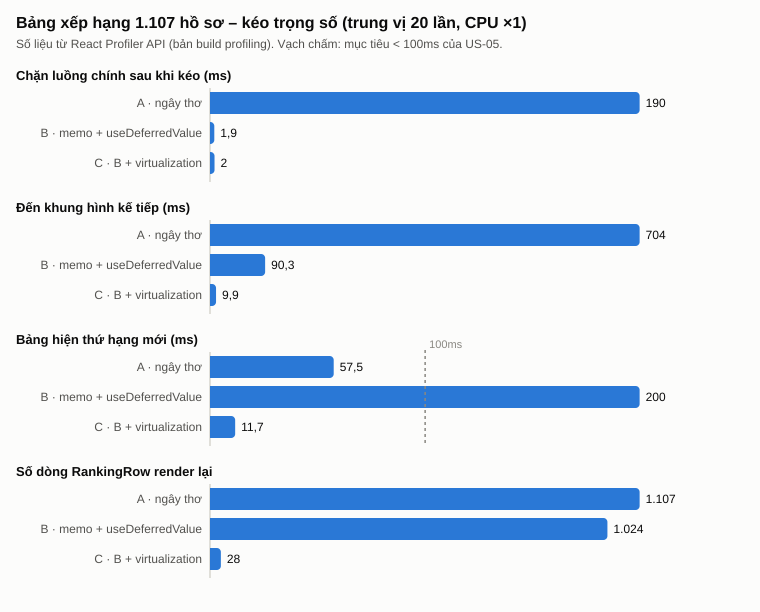
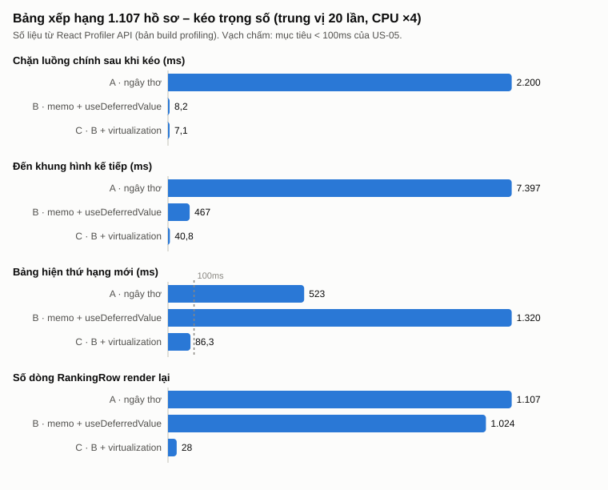

# Rendering trong HireFlow: CSR, SSR, SSG, ISR và số liệu đo

Tài liệu minh chứng cho yêu cầu "phân biệt các cách render" và "tối ưu state" của mentor (Kickoff 1.2, 15.1, 22.1; FE Architecture 2.2, 9.1). Mọi con số dưới đây đo trên code thật của repo, có script để chạy lại (mục 7).

**Tóm tắt**

| Câu hỏi | Trả lời ngắn |
| --- | --- |
| Ứng dụng render kiểu gì? | Trang nội bộ là **CSR** (Vite + React). Trang job công khai được **prerender lúc build (SSG)** rồi hydrate ở trình duyệt; HTML được build lại khi job đổi, giống **ISR theo yêu cầu**. Không dùng SSR mỗi request, không dùng Next.js (ADR-008). |
| Prerender được gì? | Tắt JavaScript vẫn đọc được toàn bộ danh sách job (CSR: trang trắng). Lighthouse mobile: LCP 3,42 s → 2,68 s, Performance 88 → 94, SEO 82 → 100. |
| Bảng xếp hạng 1.107 hồ sơ có đạt US-05 (< 100 ms) không? | Có, sau khi thêm virtualization: bảng hiện thứ hạng mới sau **11,7 ms** (CPU thường) và **86 ms** (CPU chậm 4 lần). Bản viết ngây thơ chặn trình duyệt 190 ms – 2,2 s mỗi lần kéo. |
| `memo` có đủ không? | Không. Đổi trọng số làm gần như mọi dòng đổi hạng, nên `memo` chỉ bỏ qua được ~8% số dòng. Chi phí chính nằm ở DOM 1.107 dòng, chỉ virtualization mới giải quyết được. |

**Cấu hình đo**: Intel Core i7-11850H (8 nhân, 16 luồng), RAM 16 GB, Windows 11, Chrome 155 headless, Node 22. API NestJS và PostgreSQL 18 chạy trên cùng máy (Docker). Ngày đo 26/10/2026.

---

## 1. Bốn cách render

| | CSR | SSR | SSG (prerender) | ISR |
| --- | --- | --- | --- | --- |
| HTML đầu tiên | Rỗng: `<div id="root"></div>` | Đủ nội dung, tạo **mỗi request** | Đủ nội dung, tạo **lúc build** | Như SSG, nhưng trang được tạo lại sau một khoảng thời gian hoặc khi có sự kiện |
| Cần server chạy JS khi phục vụ | Không (file tĩnh) | Có | Không | Có cơ chế build lại (nền tảng hoặc hook) |
| Dữ liệu mới nhất | Luôn mới (gọi API ở trình duyệt) | Luôn mới | Cũ bằng thời điểm build | Cũ tối đa bằng chu kỳ làm mới |
| SEO, xem trước khi chia sẻ link | Kém: bot phải chạy JS | Tốt | Tốt | Tốt |
| Hợp với | Trang sau đăng nhập, dữ liệu riêng từng người | Trang công khai đổi liên tục, cá nhân hoá | Trang công khai ít đổi | Trang công khai đổi theo sự kiện |

**Hydrate**: với SSR/SSG, trình duyệt nhận HTML có sẵn rồi React "gắn" sự kiện vào đúng các node đó thay vì vẽ lại. Hai bên phải ra cùng một cây; lệch thì React bỏ HTML và vẽ lại từ đầu (mất lợi ích, có thể nháy).

## 2. HireFlow chọn gì cho từng trang

| Trang | Cách render | Lý do |
| --- | --- | --- |
| `/jobs` – danh sách job đang tuyển | SSG + hydrate, build lại khi job đổi | Cần SEO và mở nhanh trên điện thoại; dữ liệu chỉ đổi khi HR đăng hoặc đóng job |
| `/jobs/:id` – chi tiết job + form nộp CV | SSG + hydrate; form là phần tương tác sau hydrate | Nội dung JD cần SEO (có JSON-LD `JobPosting`); form cần JS |
| Dashboard, bảng hồ sơ, xếp hạng, kho ứng viên, chat AI | CSR | Sau đăng nhập, dữ liệu theo quyền từng người, không cần SEO |
| Chat AI | CSR + stream (SSE qua `fetch`) | Câu trả lời đến dần từng phần |

Không chuyển sang Next.js (ADR-008): chỉ 2 trang cần HTML sẵn, nên khoảng 300 dòng code prerender (`src/prerender/`, `scripts/prerender.mjs`) rẻ hơn nhiều so với đổi framework cho toàn bộ ứng dụng.

### 2.1. Prerender trang công khai hoạt động thế nào

```
npm run build
  ├─ tsc -b && vite build                → dist/ (SPA như cũ)
  └─ node scripts/prerender.mjs          (bỏ qua nếu PRERENDER_API_URL trống)
       ├─ vite build --ssr src/prerender/entry.tsx
       ├─ gọi API: GET /public/jobs (trang 1, 12 job) và GET /public/jobs/:id cho mọi job đang mở
       ├─ render bằng createStaticHandler + StaticRouterProvider + renderToString,
       │  dùng đúng cây route và component của ứng dụng
       └─ ghi dist/jobs.html, dist/jobs/<id>.html (+ sitemap.xml, robots.txt)
            mỗi file có: nội dung thật, <title>, meta description, Open Graph,
            canonical, JSON-LD JobPosting, và cache TanStack Query nhúng sẵn

Trình duyệt mở /jobs/<id>
  ├─ hiện HTML ngay (chưa cần JS)
  ├─ main.tsx thấy dữ liệu nhúng sẵn → nạp vào cache Query, tải trước route lazy,
  │  tạo router với hydrationData → hydrateRoot (không vẽ lại)
  └─ dữ liệu build-time đã "cũ" → TanStack Query tải lại ngầm, cập nhật nếu job đã đổi

HR đăng / đóng / sửa job đang mở
  └─ BE gọi Vercel Deploy Hook (gộp trong 30 s) → Vercel build lại → HTML mới
```

Những chỗ phải xử lý để hydrate không lệch (đều có test, mục 3):

- **Route lazy**: nếu route của trang chưa tải xong lúc hydrate, React Router hiện màn chờ thay vì trang → lệch. `resolveLazyRoutes()` tải trước các route khớp URL.
- **Loader gốc** (khôi phục phiên đăng nhập): truyền `hydrationData` để router không chạy lại loader lúc hydrate; loader khôi phục phiên gắn thêm vào route nội bộ để đi từ trang công khai sang `/login` hay `/` vẫn đúng.
- **Ngày giờ**: "3 ngày trước" phụ thuộc thời điểm render, ngày tuyệt đối phụ thuộc múi giờ máy build (UTC) và máy người xem. HTML dựng sẵn và lần hydrate đầu dùng ngày tuyệt đối theo giờ Việt Nam; ngày tương đối chỉ hiện sau khi hydrate (`useHydrated`).
- **Không lộ dữ liệu nội bộ** (BR-JOB-07): HTML và cache nhúng chỉ chứa đúng dữ liệu API công khai trả về (không trọng số, không từ khoá) – có test.
- **API ngủ hoặc lỗi lúc build** (Render free ngủ sau 15 phút): script chờ tối đa 90 s mỗi request; lỗi thì bỏ prerender, build vẫn qua và trang chạy CSR như cũ (`PRERENDER_STRICT=true` để build báo lỗi).
- **Job mới chưa có file HTML**: Vercel không tìm thấy `jobs/<id>.html` thì rơi về `index.html` (SPA) – trang vẫn chạy, chỉ là CSR cho tới lần build kế tiếp.

## 3. "View source": CSR so với prerender

Cùng trang `/jobs`, tắt JavaScript trong trình duyệt (giống bot không chạy JS):

| | CSR | Prerender |
| --- | --- | --- |
| Nội dung trong `#root` | 0 ký tự | 33.920 ký tự |
| Link tới chi tiết job | 0 | 14 |
| `<title>` | `HireFlow` | `Việc làm đang tuyển – HireFlow Careers` |
| Meta description, canonical, JSON-LD | Không | Có |

| CSR, tắt JavaScript | Prerender, tắt JavaScript |
| --- | --- |
|  |  |

Đầu file `dist/jobs/<id>.html` (rút gọn):

```html
<title>QA Automation Engineer – HireFlow Careers</title>
<meta name="description" content="QA Automation Engineer · Kiểm thử chất lượng · Hà Nội. Đảm bảo chất lượng cho hệ thống…" />
<link rel="canonical" href="https://hireflow.vercel.app/jobs/2af27a56-…" />
<script type="application/ld+json">{"@context":"https://schema.org","@type":"JobPosting","title":"QA Automation Engineer",…}</script>
…
<div id="root"><div class="flex min-h-screen flex-col bg-white"><header …>…<h1 …>QA Automation Engineer</h1>…</div></div>
<script>window.__HIREFLOW_PRERENDER__={"queryState":{…}}</script>
```

Kiểm tra hydrate (Chrome thật, `scripts/perf` mục 7): sau khi JS chạy, **0 node bị thay** trong `#root`, console không có lỗi hydrate, và trình duyệt gọi lại `GET /api/v1/public/jobs…` để làm mới dữ liệu. Test `src/prerender/entry.test.tsx` kiểm điều này tự động; khi cố ý bỏ bước tải trước route lazy, test báo đỏ với lỗi "Hydration failed".

## 4. Lighthouse

Chế độ mobile mặc định của Lighthouse 12 (giả lập Moto G Power, mạng Slow 4G, CPU chậm 4 lần), trung vị 3 lần chạy, cache trống. Báo cáo đầy đủ: chạy lại bằng `scripts/perf/lh.mjs`.

**Lần đo đầu cho thấy prerender chưa có tác dụng**: FCP của CSR và prerender gần như bằng nhau (~2,58 s). Lighthouse chỉ ra nguyên nhân: file CSS của Google Fonts **chặn render ~0,9 s**, cả hai cách đều phải chờ nó rồi mới vẽ được gì. Sau khi đổi font sang tải không chặn (`rel="preload"` rồi chuyển thành stylesheet khi tải xong, `display=swap`) và thêm `robots.txt`, HTML dựng sẵn mới phát huy:

| Trang | Cách render | Performance | SEO | FCP | LCP | TBT |
| --- | --- | ---: | ---: | ---: | ---: | ---: |
| `/jobs` | CSR, font chặn render | 88 | 82 | 2.576 ms | 3.429 ms | 41 ms |
| `/jobs` | Prerender, font chặn render | 88 | 91 | 2.583 ms | 3.269 ms | 123 ms |
| `/jobs` | CSR, font không chặn | 88 | 91 | 2.533 ms | 3.419 ms | 43 ms |
| `/jobs` | **Prerender, font không chặn** | **94** | **100** | **2.307 ms** | **2.683 ms** | 53 ms |
| `/jobs/:id` | CSR, font chặn render | 86 | 82 | 2.686 ms | 3.423 ms | 29 ms |
| `/jobs/:id` | CSR, font không chặn | 87 | 91 | 2.574 ms | 3.418 ms | 41 ms |
| `/jobs/:id` | **Prerender, font không chặn** | **93** | **100** | **2.260 ms** | **2.739 ms** | 82 ms |
| `/` dashboard | CSR (đã đăng nhập, cache ấm) | 100 | – | 1.088 ms | 1.429 ms | 28 ms |

Đọc bảng:

- **LCP giảm ~0,7 s** (3,42 s → 2,68–2,74 s): phần tử lớn nhất (đoạn mô tả JD, danh sách job) có ngay trong HTML, không phải chờ JS tải, chạy và gọi API.
- **SEO 82 → 100**: CSR thiếu meta description (chỉ có sau khi JS chạy) và thiếu `robots.txt`.
- **TBT tăng 10–40 ms** ở bản prerender: đây là chi phí hydrate (React duyệt lại cây có sẵn). Vẫn thấp hơn nhiều ngưỡng 200 ms của Lighthouse.
- **FCP còn ~2,3 s** chủ yếu do file CSS Tailwind (chặn render ~0,45 s) và độ trễ mạng giả lập. Có thể giảm tiếp bằng inline CSS quan trọng; chưa làm vì lợi ích nhỏ so với rủi ro.
- **Dashboard** đo sau khi đăng nhập nên cache đã ấm; chỉ để tham khảo, không so được với trang công khai. Dashboard không cần SEO, `robots.txt` cố ý chặn mọi trang trừ `/jobs`.

## 5. Tải dữ liệu song song với code (loader của React Router)

Trang Bảng hồ sơ dùng loader gọi `queryClient.ensureQueryData(...)` ngay khi bắt đầu điều hướng (FE Architecture 2.1), thay vì đợi component mount mới gọi API. Đo khi bấm từ Dashboard sang Bảng hồ sơ, mạng Slow 4G (độ trễ 150 ms, 1,6 Mbps), tắt cache, trung vị 5 lần:

| | Request API bắt đầu (tính từ lúc bắt đầu tải JS của trang) | JS của trang tải xong | API trả về | Bảng hiện ra (từ lúc bấm) |
| --- | ---: | ---: | ---: | ---: |
| Không có loader | +194 ms (sau khi JS tải xong và component mount) | 173 ms | 440 ms | 485 ms |
| **Có loader** | **+2 ms (song song)** | 197 ms | **223 ms** | **269 ms** |

Waterfall:

```
Không loader:  [── JS trang ──][mount][──── API ────]→ hiện bảng   485 ms
Có loader:     [── JS trang ──]
               [──── API ────]→ hiện bảng                          269 ms (−45%)
```

## 6. Bảng xếp hạng + thanh trọng số: đo bằng React Profiler

US-05: kéo thanh trọng số thì bảng xếp hạng cập nhật **dưới 100 ms** trên trình duyệt, không gọi LLM. Đo trên job "Backend Developer (NestJS)" với **1.107 hồ sơ đã chấm** (DB hiệu năng 200k hồ sơ, `npm run seed:perf`), cuộn tới giữa danh sách, mỗi bản kéo 20 lần lần lượt trên 4 thanh.

### 6.1. Ba phiên bản

| Bản | Cách viết |
| --- | --- |
| A · ngây thơ | Mỗi lần kéo tính lại và render lại toàn bộ bảng ngay trong sự kiện kéo; dòng không bọc `memo` |
| B · `memo` + `useDeferredValue` | Bản trước D3: dòng bọc `memo` với props ổn định; bảng xếp hạng tính theo trọng số "trễ một nhịp" để thanh kéo luôn phản hồi trước |
| C · B + virtualization | Bản hiện tại: thêm `@tanstack/react-virtual` (`useWindowVirtualizer`) khi bảng trên 200 dòng – chỉ render các dòng đang nhìn thấy cộng 8 dòng đệm; bảng bọc `memo` để lượt render khẩn cấp (thanh kéo) không chạm tới bảng |

Bản A và B được build tạm từ code hiện tại (bỏ `memo`, `useDeferredValue`, virtualization), không nằm trong repo. Số liệu lấy từ React Profiler API (`<Profiler id="ranking-table" onRender>`, chỉ hoạt động ở bản `npm run build:profile`) và `performance.now()` trong trang.

### 6.2. Kết quả (trung vị / p95 của 20 lần kéo)

CPU bình thường:

| Chỉ số | A · ngây thơ | B · memo + deferred | C · + virtualization |
| --- | ---: | ---: | ---: |
| Dòng `<tr>` trong DOM | 1.107 | 1.107 | 28 |
| Chặn luồng chính ngay sau khi kéo | 190 / 215 ms | 1,9 / 4,2 ms | 2,0 / 3,0 ms |
| Đến khung hình kế tiếp (thanh kéo nhích) | 704 / 812 ms | 90 / 120 ms | **9,9 / 26 ms** |
| Bảng hiện thứ hạng mới | 58 / 75 ms * | 200 / 297 ms | **11,7 / 15,4 ms** |
| Thời gian render bảng (Profiler `actualDuration`) | 48 / 65 ms | 60 / 101 ms | 4,1 / 7,1 ms |
| Số dòng `RankingRow` render lại | 1.107 | 1.024 | 28 |

CPU chậm 4 lần (giả lập máy yếu):

| Chỉ số | A · ngây thơ | B · memo + deferred | C · + virtualization |
| --- | ---: | ---: | ---: |
| Chặn luồng chính ngay sau khi kéo | 2.200 / 3.658 ms | 8,2 / 16,8 ms | 7,1 / 12,2 ms |
| Đến khung hình kế tiếp | 7.397 / 8.383 ms | 467 / 663 ms | **41 / 50 ms** |
| Bảng hiện thứ hạng mới | 523 / 1.134 ms * | 1.320 / 2.200 ms | **86 / 132 ms** |
| Thời gian render bảng (Profiler) | 467 / 1.026 ms | 444 / 852 ms | 35 / 63 ms |

\* Bản A "xong sớm" hơn B chỉ vì nó render đồng bộ ngay trong sự kiện kéo – đổi lại trình duyệt đứng hình suốt thời gian đó (hàng "chặn luồng chính" và "khung hình kế tiếp").





### 6.3. Rút ra

1. **A không dùng được**: mỗi lần kéo trình duyệt đứng 0,2 s (máy yếu: 2,2 s), thanh kéo giật theo. Phần lớn thời gian không nằm ở React mà ở trình duyệt tính lại layout cho bảng 1.107 dòng (khung hình kế tiếp 0,7 s so với render 48 ms).
2. **`useDeferredValue` cứu được thanh kéo** (B: chặn còn 2 ms), nhưng bảng vẫn chậm 0,2–1,3 s vì việc nặng chỉ bị dời ra sau chứ không mất đi.
3. **`memo` gần như không giúp**: đổi một trọng số làm điểm và hạng của 1.024/1.107 dòng thay đổi, nên chỉ ~8% dòng được bỏ qua. `memo` chỉ có ích khi phần lớn props giữ nguyên.
4. **Virtualization giải quyết gốc**: chi phí tỉ lệ với số dòng nhìn thấy (28), không phải tổng số dòng. Đạt US-05 cả ở CPU chậm 4 lần (trung vị 86 ms).
5. Đánh đổi của virtualization: Ctrl+F của trình duyệt không tìm thấy dòng ngoài màn hình, in trang chỉ ra phần đang hiện. Chấp nhận được vì bảng hồ sơ (có tìm kiếm, phân trang) mới là nơi tra cứu; dưới 200 dòng thì không bật virtualization.

### 6.4. Xem bằng React DevTools

1. `npm run build:profile && npx vite preview --outDir dist-profile` (bản build giữ lại thông tin cho Profiler).
2. Mở trang xếp hạng của một job nhiều hồ sơ, mở DevTools → tab **Profiler** → bấm ghi, kéo một thanh trọng số, dừng ghi.
3. Flamegraph cho thấy `RankingTable` và số `RankingRow` được render trong mỗi commit; bật "Highlight updates when components render" để thấy dòng nào vẽ lại khi kéo.

## 7. Chạy lại các phép đo

Script nằm ở `fe/scripts/perf/`, cần Chrome và hai gói không có trong `package.json` (chỉ dùng để đo):

```bash
cd fe
npm i --no-save puppeteer-core@24 lighthouse@12
# Chrome ở chỗ khác thì đặt CHROME_PATH

# Prerender với API local, rồi phục vụ bản build
PRERENDER_API_URL=http://localhost:3000/api/v1 npm run build
npx vite preview --port 4173

node scripts/perf/nojs.mjs docs/images                          # ảnh tắt JS (CSR ở :4185, prerender ở :4173)
node scripts/perf/lh.mjs <thư-mục-báo-cáo> "jobs|http://localhost:4173/jobs"
node scripts/perf/waterfall.mjs http://localhost:4173           # LOGIN_EMAIL=hr@hireflow.dev

# Bảng xếp hạng: API trỏ vào DB hiệu năng, bản build profiling
npm run build:profile && VITE_PROXY_TARGET=http://localhost:3001 npx vite preview --outDir dist-profile --port 4183
node scripts/perf/bench-ranking.mjs http://localhost:4183 <jobId> <cpu 1|4> 20 0.5   # LOGIN_EMAIL=hr01@perf.local
node scripts/perf/chart.mjs <file kết quả .jsonl> docs/images
```

Trên Git Bash (Windows) thêm `MSYS_NO_PATHCONV=1` trước lệnh `node` để đường dẫn `/jobs` không bị đổi thành đường dẫn Windows.
